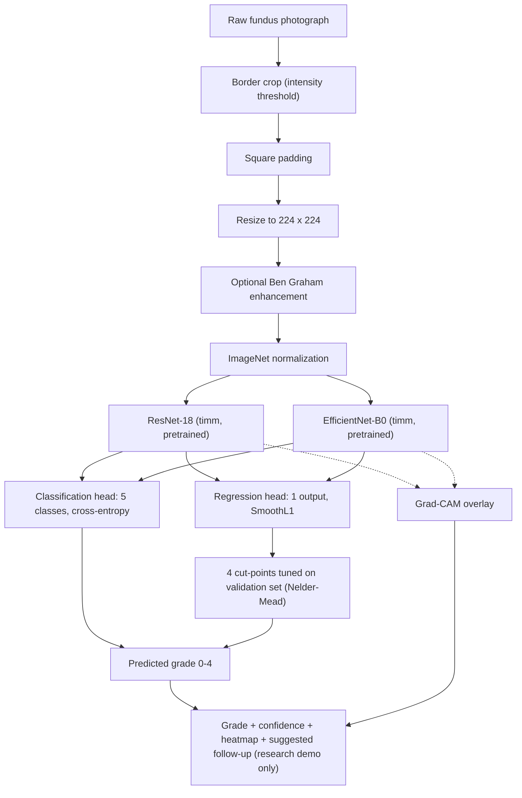

# RetinoCheck AI

> **RetinoCheck AI: Explainable diabetic retinopathy screening from a single retina image.**

[](LICENSE)
[](https://www.python.org/)
[](https://pytorch.org/)
[](https://gradio.app/)
[](https://huggingface.co/spaces)

---

> ### ⚠️ Medical & Regulatory Disclaimer
> **RetinoCheck AI is an experimental machine learning research prototype developed solely for benchmarking and educational purposes.**
>
> It is **NOT** a certified medical device (FDA, CE, or equivalent), has **NOT** undergone prospective clinical validation or clinical trials, and must **NEVER** be used for clinical diagnosis, patient triage, treatment planning, or professional medical advice. Grad-CAM attention maps show gradient sensitivity of the network, not validated clinical lesions or diagnostic reasoning. Always consult a licensed ophthalmologist or qualified eye care provider for medical evaluation.

---

## 📌 Problem Overview

Diabetic retinopathy (DR) is a leading cause of preventable blindness in the working-age population. Early detection through retinal fundus examinations is critical, yet many people with diabetes lack access to trained retinal specialists.

Automated DR grading from color fundus photographs is difficult for several reasons:

1. **Ordinality**: severity progresses from no disease to proliferative stages (0 < 1 < 2 < 3 < 4). Plain cross-entropy treats confusing grade 0 with grade 4 the same as confusing grade 0 with grade 1.
2. **Class imbalance**: grade 0 dominates the dataset, while mild (grade 1) and severe (grade 3) cases are minorities.
3. **Subtle pathology**: early lesions such as microaneurysms are tiny and can be lost when images are downsampled to 224×224.
4. **Opacity**: standard networks give no visual justification, and can learn shortcuts from camera borders or sensor artifacts.

RetinoCheck AI explores these issues by comparing **5-class classification** against **ordinal regression with optimized cut-points**, using **Ben Graham-style color enhancement** and **Grad-CAM** attention maps.

---

## 🏗️ Pipeline



---

## 📊 Results

Dataset: APTOS 2019 (`bumbledeep/aptos`), stratified 70/15/15 split, seed 42, test split of 550 images. All four configurations use L2 regularization (`weight_decay=0.01`), 224×224 input, and one training run each (no repeated seeds).

Source: `reports/results.csv`.

| Model | Formulation | Regularization | Accuracy | Macro F1 | QWK |
| :--- | :--- | :--- | :---: | :---: | :---: |
| ResNet-18 | classification | L2 (wd=0.01) | 0.7491 | **0.5968** | 0.8570 |
| ResNet-18 | regression | L2 (wd=0.01) | 0.6764 | 0.4113 | **0.8603** |
| EfficientNet-B0 | classification | L2 (wd=0.01) | **0.7600** | 0.5860 | 0.8274 |
| EfficientNet-B0 | regression | L2 (wd=0.01) | 0.4982 | 0.2690 | 0.6496 |

**Reading these results honestly**

- **Best QWK (main metric):** ResNet-18 regression (0.8603), but ResNet-18 classification is practically tied (0.8570). With a single run per configuration and a 550-image test set, a 0.003 gap is within noise.
- **Best accuracy:** EfficientNet-B0 classification (0.7600). **Best macro F1:** ResNet-18 classification (0.5968).
- **Regression vs. classification:** for ResNet-18, regression gave a similar QWK but lower accuracy and macro F1. It did not clearly help.
- **EfficientNet-B0 regression underperformed** (accuracy 0.4982, QWK 0.6496). This is most likely a training or cut-point-fitting problem in this particular run, not evidence that the architecture is poor at this task. It has not been investigated yet.
- No hyperparameter search or multi-seed averaging was done, so differences between models should be treated as preliminary.

### Per-class recall

Per-class recall and confusion matrices have **not been added to this README yet**. They are produced by `notebooks/06_evaluation_gradcam.ipynb` and the per-model folders under `reports/`. Overall QWK can hide weak performance on minority grades (especially grades 1 and 3), so check per-class recall before drawing conclusions.

| Model | Formulation | G0 | G1 | G2 | G3 | G4 |
| :--- | :--- | :---: | :---: | :---: | :---: | :---: |
| ResNet-18 | classification | TBD | TBD | TBD | TBD | TBD |
| ResNet-18 | regression | TBD | TBD | TBD | TBD | TBD |
| EfficientNet-B0 | classification | TBD | TBD | TBD | TBD | TBD |
| EfficientNet-B0 | regression | TBD | TBD | TBD | TBD | TBD |

---

## 🖼️ Screenshots

Real screenshots will be added here:

- `reports/gradcam_examples.png`: Grad-CAM grid of correct and incorrect predictions
- `reports/preprocessing_examples.png`: before/after preprocessing
- Gradio app screenshot: *(to be added)*

---

## 🚀 How to Run in Google Colab

Training is designed for the free Google Colab **T4 GPU**.

### 1. Setup
1. Open Colab and set **Runtime → Change runtime type → T4 GPU**.
2. Run this in the first cell:

```python
from google.colab import drive
drive.mount('/content/drive')

!git clone https://github.com/ratuhin1122/retinocheck-ai.git
%cd /content/retinocheck-ai

# Colab already ships with PyTorch, so skip the pinned torch/numpy lines
!grep -v -E "^(torch|torchvision|numpy)==" requirements.txt > /tmp/req.txt
!pip install -q -r /tmp/req.txt
```

Pip may print dependency-conflict warnings about unrelated Colab packages; these can be ignored. If a library error appears, restart the session (**Runtime → Restart session**) and re-run.

Checkpoints, splits, caches and reports are saved to Google Drive under `MyDrive/RetinoCheckAI/`, so work survives a Colab disconnect.

### 2. Run the notebooks in order

Free Colab allows only a few simultaneous sessions. Run **one notebook at a time**, and use **Runtime → Disconnect and delete runtime** when it finishes.

| Notebook | Purpose |
| :--- | :--- |
| `01_data_exploration.ipynb` | Downloads APTOS 2019, validates images, freezes stratified 70/15/15 splits, plots class distribution |
| `02_preprocessing.ipynb` | Border cropping, square padding, Ben Graham enhancement |
| `03_train_resnet18.ipynb` | Trains ResNet-18 (AdamW, cosine schedule, mixed precision, validation-QWK checkpointing) |
| `04_train_efficientnet_b0.ipynb` | Trains EfficientNet-B0 with identical splits and settings |
| `05_regression_vs_classification.ipynb` | Trains classification and ordinal-regression variants and tunes 4 cut-points on the validation set |
| `06_evaluation_gradcam.ipynb` | Evaluates on the held-out test set and generates the Grad-CAM audit grid |

To run all of them in one session instead, convert them to scripts and run them in sequence:

```python
import subprocess, os
os.chdir("/content/retinocheck-ai")
nbs = ["01_data_exploration", "02_preprocessing", "03_train_resnet18",
       "04_train_efficientnet_b0", "05_regression_vs_classification",
       "06_evaluation_gradcam"]
os.makedirs("/content/scripts", exist_ok=True)
for nb in nbs:
    subprocess.run(["jupyter", "nbconvert", "--to", "python",
                    f"notebooks/{nb}.ipynb", "--output-dir", "/content/scripts"], check=True)
for nb in nbs:
    get_ipython().run_line_magic("run", f"/content/scripts/{nb}.py")
```

> Colab's `/content` folder is deleted when the session ends. Copy `reports/` to Drive or download it before disconnecting.

### 3. Launch the Gradio demo in Colab

```bash
python -m app.gradio_app --share
```

This prints a temporary public `gradio.live` link (it expires).

---

## 💻 Local & Hugging Face Spaces Deployment

*A hosted Space is planned but not live yet.*

### Local (CPU)
```bash
git clone https://github.com/ratuhin1122/retinocheck-ai.git
cd retinocheck-ai
pip install -r requirements.txt
python app.py
```
Open `http://localhost:7860`. Trained weights are not stored in this repository; see below.

### Hugging Face Space (planned)
1. Upload the chosen `best.pt` to a Hugging Face **model** repository (not GitHub).
2. Create a free Gradio Space (CPU).
3. Set the environment variable `HF_MODEL_REPO = "<username>/retinocheck-models"`.
4. Push `app.py`, `app/`, `src/` and `requirements.txt`; the Space downloads the weights on startup.

---

## 📂 Repository Structure

```text
retinocheck-ai/
├── README.md
├── MODEL_CARD.md
├── LICENSE
├── requirements.txt
├── app.py                  # Entry point for Hugging Face Spaces
├── app/
│   ├── __init__.py
│   └── gradio_app.py       # Gradio UI, confidence and Grad-CAM pipeline
├── src/
│   ├── config.py           # Paths, hyperparameters, class constants
│   ├── data.py             # Dataset loading and stratified splits
│   ├── preprocess.py       # Border crop, padding, Ben Graham enhancement
│   ├── model.py            # timm model factory
│   ├── train.py            # Resumable training loop, threshold search
│   ├── evaluate.py         # Test evaluation and report generation
│   ├── explain.py          # Grad-CAM
│   └── compare.py          # Comparison across configurations
├── notebooks/
│   ├── 01_colab.ipynb
│   ├── 01_data_exploration.ipynb
│   ├── 02_preprocessing.ipynb
│   ├── 03_train_resnet18.ipynb
│   ├── 04_train_efficientnet_b0.ipynb
│   ├── 05_regression_vs_classification.ipynb
│   ├── 06_evaluation_gradcam.ipynb
│   └── colab_setup.py
├── reports/
│   ├── results.csv
│   ├── model_comparison.md
│   ├── VALIDATION.md
│   ├── gradcam_examples.png
│   ├── preprocessing_examples.png
│   └── <model>_<mode>/     # Per-model outputs
└── tests/
    ├── test_preprocess.py
    ├── test_data_splits.py
    └── test_gradio_app.py
```

---

## 📜 Dataset & Licensing Notes

- **Dataset**: [APTOS 2019 Blindness Detection](https://www.kaggle.com/competitions/aptos2019-blindness-detection/data), loaded via [bumbledeep/aptos](https://huggingface.co/datasets/bumbledeep/aptos).
- **License**: APTOS 2019 was released under competition-specific research terms. This repository's MIT license covers only the code and documentation. It does not grant rights to the underlying medical images or to the pretrained `timm` ImageNet weights.
- **Privacy**: use only de-identified, publicly released research images. Never upload protected health information.

---

## ⚠️ Limitations

1. **Not clinically validated.** Results come from a single public dataset and one training run per configuration.
2. **No external test set.** The models were not evaluated on a different dataset or camera type, so generalization is unknown.
3. **Minority-grade performance is unreported here.** Per-class recall is still to be added, and weak recall on grades 1 and 3 is likely given the class imbalance.
4. **EfficientNet-B0 regression run failed to train well** (QWK 0.6496) and has not been debugged.
5. **Low resolution.** 224×224 inputs may lose small lesions such as microaneurysms.
6. **Single-field images.** APTOS contains single-field fundus photographs, while formal grading often uses multi-field imaging.
7. **Grad-CAM** shows where the network's gradients are sensitive, not verified lesions, and can highlight borders or artifacts.
8. **No out-of-distribution or image-quality check.** Non-fundus or poor-quality images can still receive a confident-looking prediction.

---

## ⚖️ Legal & Medical Disclaimer

**DO NOT USE FOR CLINICAL TRIAGE, DIAGNOSIS, OR TREATMENT DECISIONS.**

This software is provided "as is" under the MIT License, without warranty of any kind. The authors assume no liability for any harm resulting from its use or misuse. Medical decisions about eye health must be made by a qualified doctor or ophthalmologist.